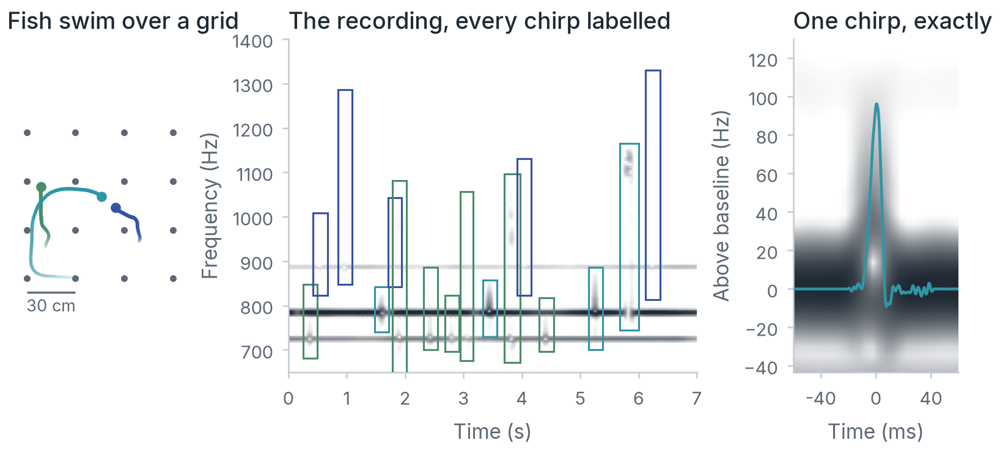

# gridtools

Read and simulate electrode-grid recordings of wave-type weakly electric
fish, with exact ground truth for every chirp.

<picture>
  <source media="(prefers-color-scheme: dark)" srcset="assets/overview-dark.png">
  
</picture>

<sub>A simulated scene. Left: three fish swim over a 4 × 4 electrode grid
for seven seconds (paths fade into the past). Middle: the recording they
make (spectrogram, power summed over the electrodes) with every chirp's
ground-truth box in its fish's colour, including chirps too faint to see.
Right: one chirp up close, with the frequency the simulator generated it
with.</sub>

## Install

```sh
pip install "gridtools @ git+https://github.com/weygoldt/gridtools"
pip install "gridtools[plot] @ git+https://github.com/weygoldt/gridtools"   # with annotated spectrograms and reports
```

Python 3.13 or later. The `gridtools` on PyPI is a different package;
install from GitHub. [Installation](docs/installation.md) covers uv and
pinning a release.

## What it does

- **Read recordings** (`gridtools.io`): fishgrid and wav recordings,
  memory-mapped and in volts, electrode geometry, wavetracker frequency
  tracks and label files.
- **Simulate them** (`gridtools sim`): chirping fish with drifting EODs and
  harmonics, moving through a dipole field to the electrodes, over
  synthetic noise or real background recordings. Every chirp comes with its
  timing, size, spectrogram footprint and visibility, defined on the
  emitter's noise-free frequency.
- **Build what the simulator draws from**: a library of real chirp
  templates split by fish (`gridtools.templates`), a library of chirp-free
  background recordings (`gridtools.background`), and the calibration of
  its defaults against real recordings (`gridtools.calibrate`).

gridtools makes the training and test data of
[chirpdetector](https://github.com/weygoldt/chirpdetector).

## Simulate

```sh
export GRIDTOOLS_TEMPLATES=/path/to/template/library
gridtools sim run default --seeds 0:10 --out scenes/default
gridtools sim plot scenes/default/000003
```

Each seed gives one scene directory: a multichannel wav, the fish's tracks
in wavetracker's format, their paths, and `chirps.csv` with every chirp's
timing, size, footprint box and visibility. `default` is the shipped config
([`default.toml`](src/gridtools/configs/scenes/default.toml)); copy it to
make your own. The simulator needs a chirp template library; the one built
from the chirp competition recordings is not public yet.
[Simulating scenes](docs/simulation.md) covers configs, hybrid scenes and
the Python API.

## Read a recording

```python
from gridtools.io import load_tracks, open_recording

recording = open_recording("path/to/recording")  # fishgrid raw or wav
samples = recording.read_time(10.0, 12.0)  # (samples, electrodes), volts
tracks = load_tracks("path/to/recording")  # wavetracker arrays
```

## Documentation

Start at [docs/README.md](docs/README.md).

- **Simulate:** [simulating scenes](docs/simulation.md) ·
  [scene outputs](docs/outputs.md) · [ground truth](docs/ground-truth.md)
- **Libraries:** [template library](docs/templates.md) ·
  [background library](docs/background.md) ·
  [calibration](docs/calibration.md)
- **Read:** [reading recordings](docs/io.md)
- **Set up:** [installation](docs/installation.md) ·
  [development](docs/development.md)

## Versions and license

This is version 2 (tag `v2.0.0`). The code of the chirp competition paper
(2024) is tag `paper-chirp-competition-v1`.

MIT.
